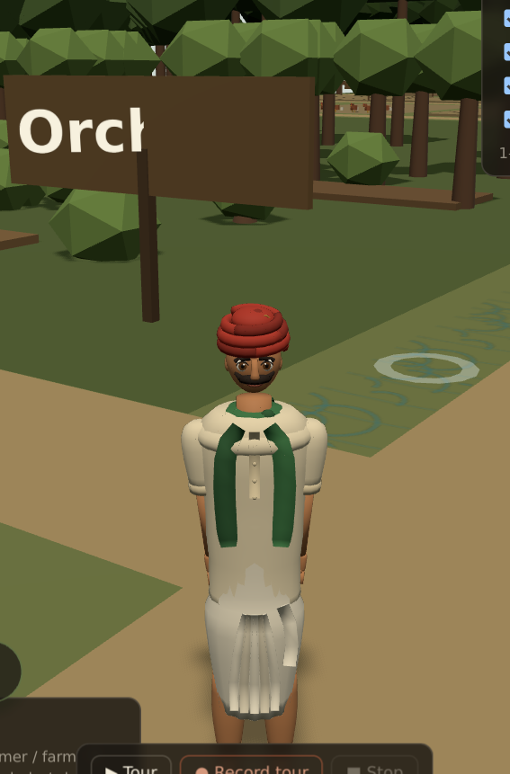

# The farmer

A rigged, animated 3D character for the hectare — built in Blender, exported as
glTF, and driven by the farm's own walk cycle.



| | |
| --- | --- |
| Source | `farm/assets/character/farmer.blend` |
| Mesh | `farm/public/models/farmer.glb` (one skinned mesh, 22 bones, 9 clips, 690 kB) |
| Builder | `farm/scripts/character/build_farmer.py` |
| Loading | `farm/src/hectare/render/farmer-model.ts` |
| Animation | `farm/src/hectare/render/farmer-motion.ts`, `farm/src/hectare/render/actor.ts` |
| Screenshots | `farm/reports/character/` — `farmer-*.png` from Blender, `farmer-world-*.png` from the app |

## What he is

A young adult village farmer: a red pagdi wound three and a half times, large
brown eyes under heavy brows, a black handlebar moustache, a cream kurta with
rolled sleeves and a buttoned placket, a white dhoti with pressed folds, a green
stole knotted at the throat, and brown leather sandals. Stylised and low-poly —
about 14.7 k triangles and 19 flat materials, no textures and no texture baking,
which is what keeps the download at 690 kB and the materials crisp at the
distance the farm camera sits.

He faces **+Z** and is **1.72 m** tall in the file. The farm works in feet, so
`farmer-model.ts` scales him by `farmer_height_m × 3.28084`, the height the
canon already gives him; nothing else in the scene changes.

It is a real mesh on a real skeleton — every view in `reports/character/` is a
screenshot of the running app, never an image on a plane. The test suite asserts
exactly that: one `SkinnedMesh`, at least twenty bones, skin weights on every
vertex, and a nine-clip animation set.

## What changed in the polish pass

The first usable pass was stiff in four places; all four were geometry, not
taste, and all four are fixed:

- **The neck was a pole.** The head sat on 90 mm of exposed neck and appeared to
  float forward of the shoulders. The neck is now shorter and thicker, it leans
  back into the spine, and a pair of trapezius masses slope from it to the
  shoulders.
- **The hands were wrong.** The palm was 28 mm wide across X while the four
  fingers spread 48 mm across it, so the fingers overhung the palm and the hand
  read as a stump. The hand is rebuilt: 74 mm across, 36 mm thick, with the
  fingers inside that width under a knuckle line, and the thumb turned in.
- **The shoulders were pads.** The sleeve was a near-constant tube capped with a
  dome, so it perched on the yoke. The sleeve now tapers into the yoke, which
  carries the shoulder line.
- **The stole was three strips.** It is now a collar that sits on the shoulders
  and is deep enough front to back to read side on, with square-cut ends.

Two more, found by looking rather than by reasoning: the dhoti was *wider* than
the kurta where the hem crossed it, so it punched through the pleats as a white
notch; and the back of the kurta was an unbroken slab, now given the yoke seam a
real one has.

One deliberate reversal: the head was briefly scaled to 1.10 for readability,
which made it 0.52 of shoulder width — a child's ratio, and the brief forbids
that. It is back at 0.38, and the shorter neck does the readability work instead.

## The rig

`root · hips · spine · chest · neck · head · turban` then
`shoulder/upper_arm/forearm/hand` and `thigh/shin/foot` on each side, plus a
`scarf_front` bone so the stole swings. Weights are distance-based (the three
nearest bones, with a squared falloff) rather than a heat solve, because Blender's
heat solver needs a UI context that `--background` has not got. Each part of the
model declares the bones allowed to move it, so the dhoti follows the hips and
the moustache follows the head regardless of what is nearby.

## The clips

| Clip | Frames @30 fps | Used for |
| --- | --- | --- |
| Idle | 96 | standing, breathing, small weight shifts |
| Walk | 32 | walking, scrubbed by the app's gait phase |
| Run | 22 | running, above ~9 ft/s |
| LookAround | 150 | standing still for a while |
| BendDown | 70 | arriving at the compost pits |
| PickUp | 96 | arriving in the orchard |
| FeedCattle | 110 | arriving at the goshala |
| WaterCrops | 90 | arriving at the beds or the pond |
| Gesture | 72 | a wave, for anywhere else |

The walk is not played on a clock. The app already computes a gait phase from
the ground covered (`src/hectare/gait.ts`), so the rig's Walk clip is *scrubbed*
to that phase and blended against Run by speed, and against Idle by how far he
is from standing. His feet stay planted at any walking speed, and the analytic
cycle that drove the old box farmer still sets the pace — which is why the
camera, the movement and the collision code did not have to change.

## Rebuilding

Blender is a hard requirement; `npm install` cannot fetch it.

```sh
# With Blender on PATH:
blender --background --python scripts/character/build_farmer.py -- --out public/models

# Or with the `bpy` module (Python 3.11), on a headless box:
python scripts/character/run_blender.py --out public/models
```

Either way it writes `public/models/farmer.glb`, saves `assets/character/farmer.blend`,
and, with `FARMER_RENDER=1`, renders the five Blender stills into
`reports/character/`.

The renders use Cycles on the CPU with the **Standard** view transform. The 4.x
default, AgX, desaturates the turban's red into salmon and greys out the blacks,
which makes a palette check against the brief meaningless.

## Verifying it in the app

The character is checked **in the running app**, not in a viewport — the brief
asks for it, and a Blender render cannot catch a bad scale, a washed-out material
under the farm's sun, or a walk cycle that skates.

```sh
npm install --no-save puppeteer-core @sparticuz/chromium
npm run dev -- --port 5175
node scripts/character/verify-farmer.mjs
```

That writes fourteen stills into `reports/character/`: front, three-quarter, side
and back from the in-app stills rig, the walk, run, gesture, feeding, watering,
bending and look-around clips, and four gameplay shots through the real follow
camera.

The stills rig is a query string, not a build flag:

```
/?inspect=farmer&orbit=0&distance=8              head on
/?inspect=farmer&orbit=40                        three-quarter
/?inspect=farmer&orbit=270                       his left side
/?inspect=farmer&orbit=180                       his back
/?inspect=farmer&clip=FeedCattle&orbit=20
/?inspect=farmer&clip=Walk&phase=0.25            the cycle, frozen mid-stride
```

`orbit` is measured from his front, so 0° is head on. The
rig also turns him towards the sun, because a backlit face tells you nothing
about a face. Without `inspect` the page is the ordinary farm.
